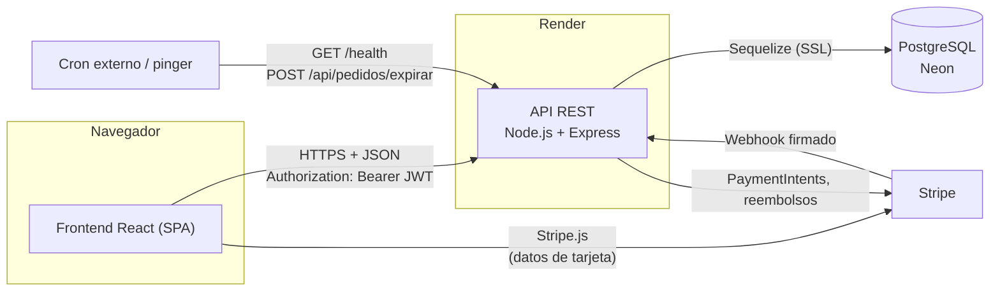
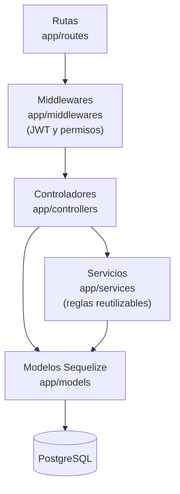
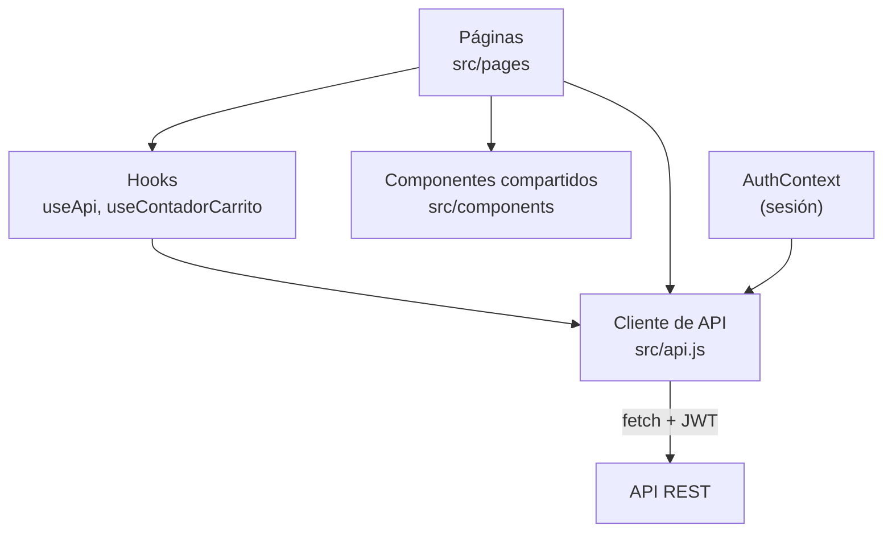

# 1. Arquitectura

## Vista general

EngineSport sigue una arquitectura cliente-servidor de tres capas. El navegador carga una aplicación de una sola página (SPA) en React que se comunica con una API REST en formato JSON. La API guarda los datos en PostgreSQL y delega el cobro con tarjeta en Stripe.

Puntos importantes:

- Los **datos de la tarjeta nunca pasan por el backend**: el navegador los envía directamente a Stripe. El backend solo conoce el `PaymentIntent`.
- El backend **no confía en el frontend para calcular dinero**: precios, descuentos, impuestos, envío y total se calculan siempre en el servidor.
- El **webhook de Stripe** es la única fuente de verdad para marcar un pedido como pagado.
- Un **cron externo** libera el stock de los pedidos que nadie pagó y mantiene despierto el servicio gratuito de Render.

## Componentes

| Componente | Repositorio | Responsabilidad |
| --- | --- | --- |
| Frontend | `EngineSport-frontend` | Interfaz de clientes y panel de administración. No tiene lógica de negocio crítica. |
| API REST | `EngineSport` | Autenticación, reglas de negocio, inventario, pedidos, pagos y reportes. |
| Base de datos | Neon (PostgreSQL) | Persistencia. El esquema se define con modelos de Sequelize y migraciones SQL. |
| Stripe | Servicio externo | Cobro con tarjeta, reembolsos y notificación de resultados por webhook. |
| Cron / pinger | Servicio externo | Llama periódicamente a `/health` y a `/api/pedidos/expirar`. |

## Capas del backend

| Capa | Carpeta | Qué hace |
| --- | --- | --- |
| Rutas | `app/routes` | Define cada endpoint y le asigna middlewares y controlador. |
| Middlewares | `app/middlewares` | Verifica el token y los permisos (empleado, cliente, dueño del recurso). |
| Controladores | `app/controllers` | Validan la petición, ejecutan la lógica del caso y arman la respuesta. |
| Servicios | `app/services` | Lógica compartida entre controladores: totales, cupones, inventario y reservas. |
| Modelos | `app/models` | Definición de tablas y relaciones con Sequelize. |

## Capas del frontend

Todas las llamadas HTTP pasan por `src/api.js`, que agrega el token y cierra la sesión cuando el servidor responde que venció.

## Roles y seguridad

El sistema tiene dos tipos de usuario, guardados en `usuarios.tipo`:

| Rol | Cómo se obtiene | Puede |
| --- | --- | --- |
| **Visitante** | Sin sesión | Ver catálogo y categorías. |
| **Cliente** | Registro público | Lo anterior, más su carrito, sus pedidos, sus pagos, su perfil y sus direcciones. |
| **Empleado** | Lo crea otro empleado | Todo lo administrativo: catálogo, inventario, pedidos, cupones, reportes, clientes, empleados y lista negra. |

Mecanismos de seguridad implementados:

- **Contraseñas** con hash `bcrypt` (10 rondas). Nunca se devuelven en las respuestas.
- **JWT** firmado con `JWT_SECRET`, con vigencia configurable (`JWT_EXPIRES_IN`, 1 h por defecto). En cada petición también se revisa que la cuenta no se haya desactivado después de emitir el token.
- **Autorización por recurso**: un cliente solo accede a sus propios pedidos, pagos, direcciones y carrito (middleware `isEmpleadoODueno`).
- **CORS** restringido a los dominios de `CORS_ORIGINS`.
- **Webhook de Stripe** verificado con la firma `STRIPE_WEBHOOK_SECRET`.
- **Cron** protegido con el encabezado secreto `x-cron-secret`, comparado en tiempo constante.
- **Inicio de sesión** con mensaje genérico ("Credenciales inválidas") para no revelar si el correo existe.
- **Lista negra** de cuentas bloqueadas como sanción, distinta de la desactivación de cuenta.
- **Consultas parametrizadas** (Sequelize y `replacements`), y el frontend prohíbe `dangerouslySetInnerHTML`.
- **Concurrencia**: el stock se descuenta dentro de transacciones con bloqueo de fila (`SELECT ... FOR UPDATE`) y en orden fijo para evitar sobreventa y deadlocks.

## Decisiones de diseño relevantes

| Decisión | Motivo |
| --- | --- |
| El stock vive en la **variante** (talla + color), no en el producto | Cada talla y color se agota de forma independiente. |
| El cliente nunca ve el stock exacto, solo un `estado` (`disponible`, `pocas_unidades`, `agotado`) | No exponer información de inventario. Solo los empleados ven cantidades. |
| El stock se **reserva al crear el pedido** y se libera si no se paga a tiempo | Evita vender dos veces la última unidad. Por defecto la reserva dura 30 minutos (`RESERVA_MINUTOS`). |
| Los registros no se borran: se **desactivan** (`activo = false`) | Se conserva el historial de pedidos, pagos y comprobantes. |
| Cada movimiento de stock genera un registro en `movimientos_inventario` | Trazabilidad y reportes de inventario. |
| Un solo módulo de cálculo de totales (`totales.service.js`) | El total que ve el cliente en el carrito es el mismo que se cobra. |
| Los importes `DECIMAL` viajan como texto (`"150.00"`) | Evita errores de punto flotante. El frontend los convierte con `Number()`. |
