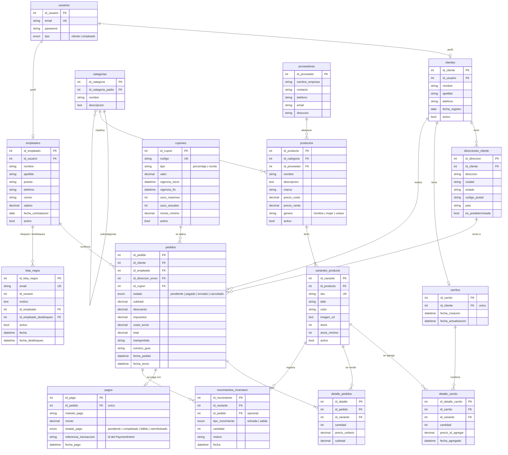

# 3. Base de datos

Motor: **PostgreSQL** (alojado en Neon). El acceso se hace con Sequelize; los modelos están en `app/models` y las relaciones en `app/models/index.js`.

## Diagrama entidad-relación

## Descripción de las tablas

### Usuarios

| Tabla | Descripción | Reglas |
| --- | --- | --- |
| `usuarios` | Credenciales de acceso. Una fila por persona con cuenta | `email` único (se compara en minúsculas). `tipo` define el rol |
| `clientes` | Perfil del cliente | Relación 1 a 1 con `usuarios`. `activo = false` desactiva la cuenta sin borrar nada |
| `empleados` | Perfil del empleado | Relación 1 a 1 con `usuarios`. Incluye salario y puesto |
| `direcciones_cliente` | Direcciones de envío | Cada cliente tiene **una sola** predeterminada. La primera que crea lo es automáticamente |
| `lista_negra` | Cuentas de clientes bloqueadas como sanción | Desbloquear no borra la fila: pone `activo = false` y guarda quién y cuándo. `id_usuario` no tiene llave foránea a propósito, para que el registro sobreviva a cambios en `usuarios` |

### Catálogo

| Tabla | Descripción | Reglas |
| --- | --- | --- |
| `categorias` | Categorías en árbol (`id_categoria_padre`) | Una categoría no puede ser su propio padre ni descendiente de sí misma. No se elimina si tiene subcategorías o productos |
| `proveedores` | Empresas que abastecen | No se elimina si tiene productos |
| `productos` | Datos comunes del artículo | `precio_venta` debe ser mayor que `precio_costo`. `genero` ∈ {hombre, mujer, unisex} |
| `variantes_producto` | Combinación concreta que se vende: talla + color + SKU | `sku` único. No se repite la combinación talla/color dentro de un producto. `stock >= 0`. Es donde vive el inventario |

### Ventas

| Tabla | Descripción | Reglas |
| --- | --- | --- |
| `carritos` | Un carrito por cliente | `id_cliente` único. Se crea al usarlo por primera vez |
| `detalle_carrito` | Líneas del carrito | Una línea por variante (`uq_carrito_variante`). Guarda `precio_al_agregar` para avisar si el precio cambió |
| `cupones` | Cupones de descuento | `tipo` es `porcentaje` o `monto`. `usos_maximos` nulo = ilimitado. No se borran: se desactivan |
| `pedidos` | Compra realizada | Guarda el desglose (subtotal, descuento, impuestos, envío, total) tal como se cobró |
| `detalle_pedidos` | Líneas del pedido | Guarda `precio_unitario` vigente al comprar, para que cambios futuros de precio no alteren pedidos pasados |
| `pagos` | Pago de un pedido | Uno por pedido (`id_pedido` único). Los reintentos reutilizan el mismo PaymentIntent |
| `movimientos_inventario` | Bitácora de entradas y salidas de stock | `cantidad >= 1`. `id_pedido` es opcional (los ajustes manuales no tienen pedido) |

## Estados

**Pedido** (`pedidos.estado`)

| Estado | Significado |
| --- | --- |
| `pendiente` | Creado, con stock reservado, esperando el pago |
| `pagado` | Stripe confirmó el pago (lo marca el webhook) |
| `enviado` | Un empleado lo despachó (con transportista y guía opcionales) |
| `cancelado` | Cancelado, expirado o reembolsado. Estado terminal |

**Pago** (`pagos.estado_pago`): `pendiente`, `completado`, `fallido`, `reembolsado`.

**Disponibilidad** (campo calculado `estado` en el catálogo, no se guarda):

| Valor | Condición |
| --- | --- |
| `agotado` | `stock <= 0` |
| `pocas_unidades` | `stock <= stock_minimo` |
| `disponible` | En cualquier otro caso |

Un producto toma el mejor estado entre sus variantes.

## Reglas de integridad referencial

| Relación | Al eliminar el padre |
| --- | --- |
| `productos` → `variantes_producto` | `CASCADE` (pero se bloquea si la variante ya tiene ventas o movimientos) |
| `clientes` → `carritos` → `detalle_carrito` | `CASCADE` |
| `variantes_producto` → `detalle_carrito` | `CASCADE` |
| `variantes_producto` → `detalle_pedidos` y `movimientos_inventario` | `RESTRICT`: no se puede borrar una variante vendida; se desactiva |
| `empleados` → `lista_negra` | `RESTRICT`: no se borra un empleado que bloqueó o desbloqueó; se desactiva |

Por esto la API responde `409` al intentar borrar productos, variantes, categorías o proveedores con datos asociados, y recomienda desactivarlos con `activo: false`.

## Migraciones

Los modelos de Sequelize crean las tablas **nuevas** al arrancar, pero `sync()` nunca modifica tablas existentes. Para esos casos se usan scripts SQL en la carpeta `sql/`, que se ejecutan a mano:

| Script | Qué hace |
| --- | --- |
| `migracion_variantes.sql` | Crea `variantes_producto`; quita `sku`, `stock` y `stock_minimo` de `productos` (ahora viven en la variante); agrega `marca`; y apunta `detalle_pedidos` y `movimientos_inventario` a la variante. **Borra los datos de prueba** de productos, pedidos, pagos y movimientos, por lo que solo debe usarse en una base sin datos reales |
| `agregar_genero_productos.sql` | Agrega la columna `genero` a `productos` (los existentes quedan como `unisex`) con su restricción de valores. Es idempotente |
| `carrito.sql` | Crea `carritos` y `detalle_carrito` |
| `lista_negra.sql` | Crea `lista_negra` |

Procedimiento recomendado:

1. Ejecutar **primero en una rama de prueba de Neon**, nunca directamente en producción.
2. Aplicar en producción antes de desplegar el código que depende del cambio.
3. Los scripts van dentro de `BEGIN; ... COMMIT;`: si algo falla, no queda a medias. Varios abortan si la tabla ya existe con datos.

## Convenciones

- Los modelos de Sequelize usan `id` como atributo, mapeado a una columna `id_<entidad>` (por ejemplo `id` ↔ `id_producto`).
- Las tablas de ventas (`pedidos`, `pagos`, `detalle_*`, `movimientos_inventario`, `cupones`, `carritos`) usan directamente el nombre `id_<entidad>` y no tienen `createdAt`/`updatedAt`.
- Los importes son `DECIMAL(10,2)`.
