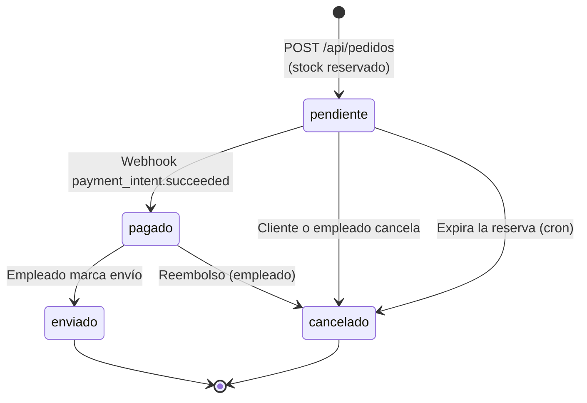

# Carrito y pedidos

## Cálculo de totales

Una sola fórmula (`app/services/totales.service.js`) se usa en la vista del carrito y al crear el pedido, para que el total mostrado sea el que se cobra.

```
base      = subtotal − descuento
impuestos = base × 12 %
envío     = ENVIO_COSTO, o 0 si base ≥ ENVIO_GRATIS_DESDE
total     = base + impuestos + envío
```

Con los valores de la plantilla de entorno: envío de Q35, gratis desde Q500 de base. El IVA no se aplica al envío. El cliente nunca envía montos: el servidor los calcula siempre.

## Carrito — `/api/carrito`

Solo para clientes autenticados. El cliente se toma del token; un empleado recibe `403`. El carrito se crea la primera vez que se usa.

| Método | Ruta | Descripción |
| --- | --- | --- |
| GET | `/api/carrito` | Devuelve el carrito con precios y stock vigentes |
| POST | `/api/carrito/items` | Agrega una variante (o suma cantidad si ya estaba). Cuerpo: `{ "id_variante": 5, "cantidad": 2 }` |
| PUT | `/api/carrito/items/:id_variante` | **Fija** la cantidad. Cuerpo: `{ "cantidad": 3 }` |
| DELETE | `/api/carrito/items/:id_variante` | Quita una variante |
| DELETE | `/api/carrito` | Vacía el carrito |

Todas aceptan `?cupon=CODIGO` y devuelven el carrito actualizado. El cupón es solo una **vista previa**: no consume usos ni se guarda.

Límites: 99 unidades por variante y 50 variantes distintas por carrito. `id_variante` y `cantidad` deben ser enteros (no texto). Agregar más unidades que el stock responde `400`.

**Respuesta**

```json
{
  "id_carrito": 3,
  "items": [
    {
      "id_variante": 5,
      "sku": "CAM-NEG-M",
      "talla": "M",
      "color": "Negro",
      "imagen_url": "/img/productos/p04-negro.webp",
      "producto": { "id": 4, "nombre": "Camiseta running" },
      "cantidad": 2,
      "precio_unitario": 129,
      "subtotal": 258,
      "estado": "disponible"
    }
  ],
  "cupon": { "codigo": "VERANO10", "valido": true, "descuento": 25.8 },
  "resumen": {
    "unidades": 2,
    "lineas": 1,
    "lineas_con_problema": 0,
    "subtotal": 258,
    "descuento": 25.8,
    "impuestos": 27.86,
    "costo_envio": 35,
    "envio_gratis_desde": 500,
    "total": 295.06
  }
}
```

**Estado de cada línea** (`items[].estado`): una línea nunca se oculta, se marca.

| Estado | Significado | Efecto |
| --- | --- | --- |
| `disponible` | Hay stock suficiente | Suma al subtotal |
| `stock_insuficiente` | Hay menos stock que lo pedido. Trae `stock_disponible` | No suma; el cliente debe ajustar la cantidad |
| `agotado` | Sin stock | No suma |
| `no_disponible` | Variante o producto desactivado | No suma |

Si el precio cambió desde que se agregó, la línea trae `precio_anterior`. Un cupón inválido no rompe el carrito: se devuelve `cupon: { valido: false, mensaje }` con los totales sin descuento.

## Pedidos — `/api/pedidos`

| Método | Ruta | Acceso | Descripción |
| --- | --- | --- | --- |
| POST | `/api/pedidos` | Empleado o dueño del `id_cliente` | Crea un pedido y reserva el stock |
| GET | `/api/pedidos` | Empleado | Todos los pedidos, del más reciente al más antiguo |
| GET | `/api/pedidos/mis-pedidos` | Cliente | Historial propio, paginado |
| GET | `/api/pedidos/cliente/:idCliente` | Empleado o dueño | Pedidos de un cliente |
| GET | `/api/pedidos/:id` | Empleado o dueño | Detalle con líneas, variante, producto y datos del pago |
| GET | `/api/pedidos/:id/comprobante` | Empleado o dueño | Comprobante en PDF (solo pedidos pagados o enviados) |
| PUT | `/api/pedidos/:id/estado` | Empleado o dueño | Cancelar o marcar como enviado |
| POST | `/api/pedidos/:id/reembolso` | Empleado | Reembolsa un pedido pagado y aún no enviado |
| POST | `/api/pedidos/expirar` | Cron | Cancela pedidos pendientes cuya reserva venció |

### `POST /api/pedidos`

**Cuerpo**

| Campo | Tipo | Obligatorio | Notas |
| --- | --- | --- | --- |
| `id_cliente` | entero | Sí | Un cliente solo puede usar el suyo |
| `id_direccion_envio` | entero | Sí | Debe pertenecer a ese cliente |
| `items` | arreglo | Sí | No vacío. Cada uno: `{ "id_variante": 5, "cantidad": 2 }`. Las variantes repetidas se suman |
| `codigo_cupon` | string | No | Se valida y se calcula en el servidor |
| `desde_carrito` | booleano | No | Con `true`, al crear el pedido se quitan del carrito las variantes compradas |
| `id_empleado` | entero | No | Solo se respeta si quien llama es empleado |

**Qué hace, en una sola transacción**

1. Libera antes el stock de las reservas vencidas.
2. Valida la dirección.
3. Bloquea cada variante (en orden por id, para evitar deadlocks), verifica que exista, esté activa y tenga stock, y descuenta el stock.
4. Usa el **precio de venta vigente** del producto (el cliente no puede mandar precios).
5. Si hay cupón, lo valida, calcula el descuento y suma un uso.
6. Calcula impuestos, envío y total.
7. Crea el pedido en estado `pendiente`, sus líneas y un movimiento de inventario de `salida` (motivo "venta") por línea.

Si algo falla, se revierte todo, incluido el stock. Respuesta `201` con el pedido y sus `detalles`. Errores: `400` datos inválidos o stock insuficiente · `404` variante o producto inexistente o inactivo.

> Un pedido **sin cupón no tiene monto mínimo**, a propósito. El mínimo (`PEDIDO_TOTAL_MINIMO`) solo se exige cuando se usa un cupón, para que el descuento no deje el total en cero o por debajo del mínimo de cobro de Stripe.

### `PUT /api/pedidos/:id/estado`

**Cuerpo**: `{ "estado": "cancelado" }` o `{ "estado": "enviado", "numero_guia": "...", "transportista": "..." }`

| Estado pedido | Quién | Condición |
| --- | --- | --- |
| `cancelado` | Dueño o empleado | Solo si el pedido está `pendiente`. Cancela el PaymentIntent en Stripe, devuelve el stock, devuelve el uso del cupón y marca el pago como `fallido` |
| `enviado` | Solo empleado | Solo si el pedido está `pagado`. `numero_guia` (máx. 100) y `transportista` (máx. 60) son opcionales, pero deben venir **juntos** |

- `pagado` **no se puede poner a mano**: lo marca el webhook de Stripe.
- `cancelado` es terminal. Un pedido pagado o enviado no se cancela por aquí: se reembolsa.
- Si el pago ya llegó o está en proceso, responde `409` ("espera unos segundos y revisa el estado").

### `POST /api/pedidos/:id/reembolso`

Reembolsa en Stripe, devuelve el stock (movimiento "reembolso de pedido"), devuelve el uso del cupón, deja el pedido `cancelado` y el pago `reembolsado`. Solo aplica a pedidos `pagado` (no enviados). Si Stripe falla, no se toca nada en la base. Respuesta: `{ "message": "Pedido reembolsado y cancelado.", "refund_id": "re_...", "pedido": {...} }`. Errores: `400` no está pagado · `404` no existe · `409` no hay un pago completado que reembolsar.

### `GET /api/pedidos/mis-pedidos`

Parámetros: `page` (por defecto 1), `limit` (por defecto 10, máximo 50), `estado` (`pendiente`, `pagado`, `enviado`, `cancelado`). Respuesta: `{ total, page, limit, totalPages, pedidos }`. El cliente sale del token; no se acepta `id_cliente`.

### `GET /api/pedidos/:id/comprobante`

Devuelve un PDF (`application/pdf`, descarga como `comprobante-pedido-<id>.pdf`) con el pedido, cliente, dirección, paquetería y guía (si hay), tabla de productos y totales (subtotal, descuento con su cupón, IVA 12 %, envío y total). Para pedidos `pendiente` o `cancelado` responde `400`.

### `POST /api/pedidos/expirar`

Lo llama un cron externo cada pocos minutos. No usa JWT: exige el encabezado `x-cron-secret` igual a `CRON_SECRET`. Si la variable no está configurada, siempre responde `401`. Procesa hasta 100 pedidos por llamada y devuelve `{ "revisados": 3, "expirados": 3 }`. Un error en un pedido no detiene a los demás.

## Ciclo de vida de un pedido


