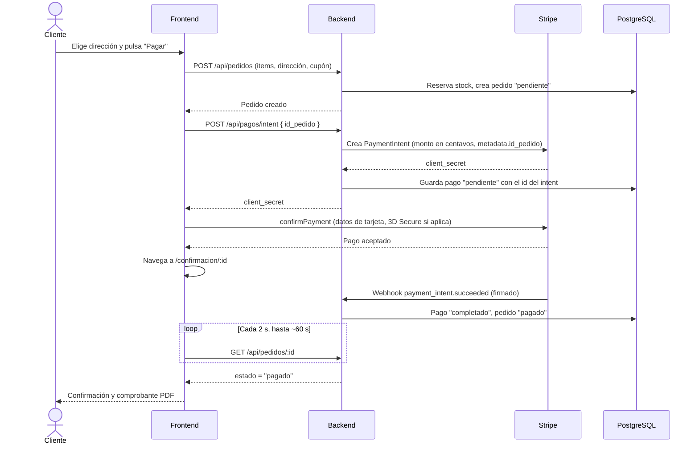

# 7. Pagos con Stripe

EngineSport cobra con tarjeta usando **Stripe PaymentIntents**. Los datos de la tarjeta los captura Stripe.js en el navegador y viajan directo a Stripe: **el backend nunca los ve**. Moneda: quetzal (`gtq`).

## Piezas involucradas

| Pieza | Dónde | Papel |
| --- | --- | --- |
| `STRIPE_SECRET_KEY` | Backend | Crear intents y reembolsos |
| `STRIPE_WEBHOOK_SECRET` | Backend | Verificar la firma de los eventos |
| `VITE_STRIPE_PUBLISHABLE_KEY` | Frontend | Cargar Stripe.js. Solo clave **pública** |
| `POST /api/pagos/intent` | Backend | Crea o reutiliza el PaymentIntent |
| `POST /api/pagos/webhook` | Backend | Recibe el resultado y actualiza pedido y pago |
| `PaymentElement` | Frontend (`PagoStripe.jsx`) | Formulario de tarjeta de Stripe |

## Flujo de un pago exitoso



La pantalla de confirmación no da por pagado el pedido porque Stripe respondió en el navegador: **espera a que el webhook lo marque**. Esa es la única fuente de verdad.

## Reglas del backend

### Un intent por pedido

- Si el pago falla, el cliente reintenta con el mismo `client_secret`.
- Si el total cambió, se **actualiza** el mismo intent.
- Si el intent estaba `canceled`, se crea uno nuevo.
- Si estaba `succeeded` o `processing`, `POST /intent` responde `409`.
- Se usa una clave de idempotencia para que un doble clic no genere dos cobros.

### Webhook

Eventos que procesa:

| Evento | Acción |
| --- | --- |
| `payment_intent.succeeded` | Pago `completado`, pedido `pagado`. Idempotente |
| `payment_intent.payment_failed` | Pago `fallido`. No devuelve el stock |
| `payment_intent.canceled` | Pago `fallido`. No devuelve el stock |

Un intento fallido **no libera el stock**, porque el cliente puede reintentar. El stock se libera al cancelar el pedido o cuando vence la reserva.

### Pago que llega tarde

Si el cliente paga justo cuando la reserva ya había expirado (pedido `cancelado`, stock devuelto), el webhook **no reactiva el pedido**: emite un reembolso automático y deja el pago como `reembolsado`. Si el reembolso falla, el webhook responde `500` y Stripe reintenta.

### Cancelación y expiración

Antes de cancelar un pedido pendiente se cancela su PaymentIntent en Stripe, para que el cliente no pueda pagar mientras se libera el stock. Si el pago ya se recibió o está en proceso, **el pedido no se cancela** (se responde `409`) y el webhook lo marcará como pagado.

### Reembolsos

Los hace un empleado con `POST /api/pedidos/:id/reembolso`, solo sobre pedidos `pagado` que no se han enviado. Stripe se llama primero; si falla, no se modifica la base. Si el cargo ya estaba reembolsado en Stripe, solo se sincroniza la base. Se usa una clave de idempotencia por intent.

## Configuración

### Claves

En el [Dashboard de Stripe](https://dashboard.stripe.com) (modo prueba) copia:

- Clave secreta `sk_test_...` → `STRIPE_SECRET_KEY` (backend).
- Clave publicable `pk_test_...` → `VITE_STRIPE_PUBLISHABLE_KEY` (frontend).

### Webhook en producción

1. Dashboard → Desarrolladores → Webhooks → **Agregar endpoint**.
2. URL: `https://<tu-backend>/api/pagos/webhook`
3. Eventos: `payment_intent.succeeded`, `payment_intent.payment_failed`, `payment_intent.canceled`.
4. Copia el **secreto de firma** (`whsec_...`) a `STRIPE_WEBHOOK_SECRET` y reinicia el backend.

### Webhook en local

```bash
stripe listen --forward-to localhost:8081/api/pagos/webhook
```

Usa el `whsec_...` que imprime la CLI.

## Tarjetas de prueba

| Tarjeta | Resultado |
| --- | --- |
| `4242 4242 4242 4242` | Pago exitoso |
| `4000 0000 0000 9995` | Rechazada por fondos insuficientes |
| `4000 0025 0000 3155` | Exige autenticación 3D Secure |

Fecha de vencimiento futura cualquiera y cualquier CVC. Lista completa en la [documentación de Stripe](https://docs.stripe.com/testing).

## Monto mínimo

Stripe no cobra montos muy pequeños ni cero. Por eso, cuando se usa un cupón, el total con IVA no puede quedar por debajo de `PEDIDO_TOTAL_MINIMO` (Q150 por defecto; ajustar al mínimo de cobro de Stripe para GTQ).

## Problemas frecuentes

| Síntoma | Causa probable |
| --- | --- |
| El pago se acepta pero el pedido sigue "pendiente" | El webhook no llega o la firma no coincide: revisa la URL y `STRIPE_WEBHOOK_SECRET` |
| `Webhook signature error` (400) | Secreto equivocado, o `express.json()` consumió el cuerpo antes. El webhook debe registrarse **antes** de `express.json()` |
| El formulario de pago no aparece | Falta `VITE_STRIPE_PUBLISHABLE_KEY` en el frontend |
| `409` al crear el intent | El pago ya fue recibido o está en proceso; espera unos segundos |
