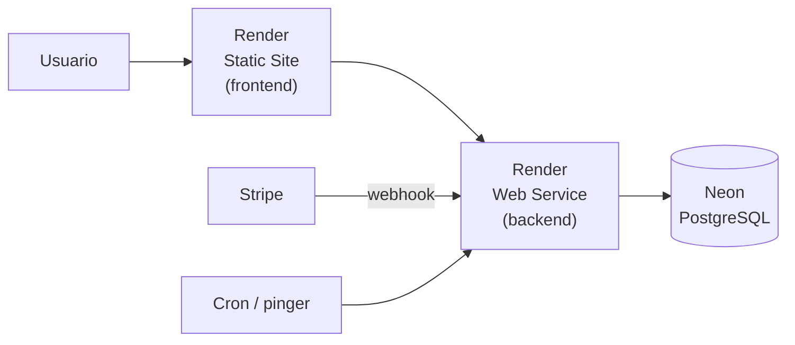

# 8. Despliegue

## Infraestructura

| Parte | Servicio | Notas |
| --- | --- | --- |
| Base de datos | [Neon](https://neon.tech) (PostgreSQL) | Exige SSL, por eso `DB_SSL=true` |
| Backend | [Render](https://render.com), Web Service | Node 24 |
| Frontend | Render, Static Site | Sitio estático compilado con Vite |
| Pagos | Stripe | Webhook apuntando al backend |
| Tareas periódicas | Servicio externo de cron/ping | Ver más abajo |

## Backend en Render

| Campo | Valor |
| --- | --- |
| Repositorio | `EngineSport` |
| Build command | `npm install` |
| Start command | `npm start` |
| Node | 24 |
| Health check | `/health` |

### Variables de entorno

Se cargan en el panel de Render (**Environment**), con las mismas claves de la [plantilla](02-instalacion.md#variables-de-entorno). Para producción:

- `NODE_ENV=production`
- `DB_*` con los datos de Neon y `DB_SSL=true`
- `JWT_SECRET` largo, aleatorio y **distinto** al de desarrollo
- `STRIPE_SECRET_KEY` y `STRIPE_WEBHOOK_SECRET` del endpoint de producción
- `CRON_SECRET` aleatorio
- `CORS_ORIGINS` con el dominio exacto del frontend (por ejemplo `https://enginesport-frontend.onrender.com`), sin `/` final

> Con `NODE_ENV=production` el servidor intenta leer `.env.production`. En Render ese archivo no existe (y no debe subirse); no hay problema, porque las variables ya vienen del panel.

### Esquema de la base

Antes del primer despliegue, o cuando una versión nueva lo requiera, aplica los scripts de `sql/` en Neon **primero en una rama de prueba**. Ver [Migraciones](03-base-de-datos.md#migraciones). Después carga los datos iniciales con los [seeds](02-instalacion.md#cargar-datos-de-prueba-seeds) y crea el primer empleado.

## Frontend en Render (Static Site)

| Campo | Valor |
| --- | --- |
| Repositorio | `EngineSport-frontend` |
| Build command | `npm install && npm run build` |
| Publish directory | `dist` |

Variables de entorno (se leen **al compilar**, así que hay que volver a desplegar si cambian):

| Variable | Valor |
| --- | --- |
| `VITE_API_URL` | URL pública del backend |
| `VITE_STRIPE_PUBLISHABLE_KEY` | `pk_test_...` |

**Regla de reescritura (obligatoria).** La app usa `BrowserRouter`, así que rutas como `/productos/4` no existen como archivos. Agrega en Render, en *Redirects/Rewrites*, la regla:

| Source | Destination | Action |
| --- | --- | --- |
| `/*` | `/index.html` | Rewrite |

Sin ella, recargar la página o abrir un enlace directo da 404.

## Tareas periódicas

El plan gratuito de Render **duerme** el servicio tras un rato sin tráfico, y la primera petición tarda unos 30 segundos. Además, hay que expirar las reservas de stock. Se configuran con un servicio externo de cron (por ejemplo cron-job.org o UptimeRobot):

| Tarea | Petición | Frecuencia sugerida |
| --- | --- | --- |
| Mantener despierto el servicio | `GET https://<backend>/health` | Cada 10 minutos |
| Liberar reservas vencidas | `POST https://<backend>/api/pedidos/expirar` con el encabezado `x-cron-secret: <CRON_SECRET>` | Cada 5 minutos |

Aunque el cron no corra, cada `POST /api/pedidos` también libera las reservas vencidas antes de validar stock.

## Webhook de Stripe

Registra `https://<backend>/api/pagos/webhook` en el Dashboard de Stripe. Pasos en [Pagos con Stripe](07-pagos-stripe.md#webhook-en-producción).

## Lista de verificación después de desplegar

- [ ] `GET /health` responde `{"status":"ok"}`.
- [ ] El frontend carga y el catálogo muestra productos.
- [ ] Recargar una ruta interna (por ejemplo `/productos`) no da 404.
- [ ] No hay errores de CORS en la consola del navegador.
- [ ] Registro e inicio de sesión funcionan.
- [ ] Una compra con la tarjeta `4242 4242 4242 4242` termina con el pedido en `pagado`.
- [ ] El comprobante PDF se descarga.
- [ ] El primer empleado puede entrar al panel de administración.
- [ ] El cron de `/health` y el de `/api/pedidos/expirar` están activos.

## Publicar esta documentación en GitBook

1. Crear una cuenta en [gitbook.com](https://www.gitbook.com) (se puede entrar con GitHub) y un **space** nuevo.
2. En el space: **Configure → GitHub Sync**, autorizar el repositorio `EngineSport` y elegir la rama `main`.
3. El archivo `.gitbook.yaml` de la raíz ya indica a GitBook que el contenido está en `docs/`, con `README.md` como portada y `SUMMARY.md` como menú. No hace falta configurar la carpeta a mano.
4. Elegir el sentido de la sincronización (se recomienda que **GitHub sea la fuente**: se edita el Markdown y GitBook se actualiza).
5. Para que se vean los diagramas, activar la integración **Mermaid** en el space, o exportarlos a imagen si no se quiere depender de ella.
6. Publicar el space y copiar la URL pública.

Alternativa sin GitBook: los mismos archivos funcionan con MkDocs (Material) y se publican gratis en GitHub Pages.
