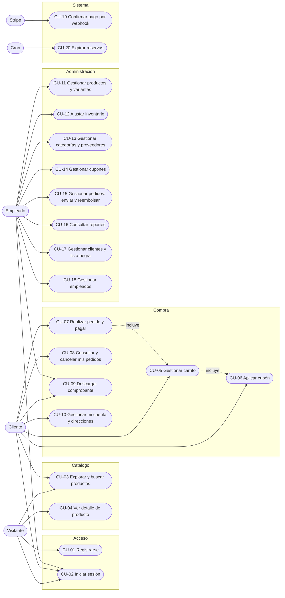

# 11. Casos de uso

## Diagrama general

Mermaid no tiene un diagrama de casos de uso nativo; se representa con un diagrama de flujo en el que los actores están a la izquierda y los casos de uso agrupados por módulo.

## Catálogo de casos de uso

| ID | Nombre | Actor principal | Requerimientos |
| --- | --- | --- | --- |
| CU-01 | Registrarse | Visitante | RF-01, RF-02 |
| CU-02 | Iniciar sesión | Visitante, Cliente, Empleado | RF-03, RF-10 |
| CU-03 | Explorar y buscar productos | Visitante, Cliente | RF-11 a RF-13, RF-16, RF-17 |
| CU-04 | Ver detalle de producto | Visitante, Cliente | RF-14, RF-15 |
| CU-05 | Gestionar carrito | Cliente | RF-26 a RF-28 |
| CU-06 | Aplicar cupón | Cliente | RF-29, RF-41 |
| CU-07 | Realizar pedido y pagar | Cliente | RF-30 a RF-32, RF-34, RF-36 |
| CU-08 | Consultar y cancelar mis pedidos | Cliente | RF-43, RF-44 |
| CU-09 | Descargar comprobante | Cliente, Empleado | RF-39 |
| CU-10 | Gestionar mi cuenta y direcciones | Cliente | RF-05 a RF-07 |
| CU-11 | Gestionar productos y variantes | Empleado | RF-18 a RF-21, RF-25 |
| CU-12 | Ajustar inventario | Empleado | RF-22, RF-23 |
| CU-13 | Gestionar categorías y proveedores | Empleado | RF-24 |
| CU-14 | Gestionar cupones | Empleado | RF-40 |
| CU-15 | Gestionar pedidos: enviar y reembolsar | Empleado | RF-38, RF-45 |
| CU-16 | Consultar reportes | Empleado | RF-47 a RF-52 |
| CU-17 | Gestionar clientes y lista negra | Empleado | RF-08, RF-09 |
| CU-18 | Gestionar empleados | Empleado | RF-04 |
| CU-19 | Confirmar pago por webhook | Stripe | RF-35, RF-37 |
| CU-20 | Expirar reservas | Cron | RF-33 |

---

## Especificaciones

### CU-01 Registrarse

| | |
| --- | --- |
| **Actor** | Visitante |
| **Precondición** | No tiene sesión |
| **Flujo principal** | 1. El visitante abre el formulario de registro. 2. Ingresa correo, contraseña y, opcionalmente, nombre, apellido y teléfono. 3. El sistema normaliza el correo, verifica que no exista, cifra la contraseña y crea el usuario y su perfil de cliente. 4. El sistema inicia la sesión y entrega el token |
| **Flujos alternos** | 3a. Faltan datos o la contraseña tiene menos de 6 caracteres: el sistema lo indica. 3b. El correo ya existe: el sistema avisa (y si pertenece a una cuenta desactivada, que debe contactar a la tienda) |
| **Postcondición** | Existe una cuenta de cliente y la sesión está iniciada |

### CU-02 Iniciar sesión

| | |
| --- | --- |
| **Actor** | Visitante (cliente o empleado) |
| **Precondición** | Tiene una cuenta |
| **Flujo principal** | 1. Ingresa correo y contraseña. 2. El sistema valida las credenciales. 3. Verifica que la cuenta no esté bloqueada ni desactivada. 4. Entrega el token y el perfil mínimo (id y nombre) |
| **Flujos alternos** | 2a. Credenciales incorrectas: mensaje genérico, sin revelar si el correo existe. 3a. Cuenta bloqueada o desactivada: se rechaza el acceso con el aviso correspondiente |
| **Postcondición** | Sesión iniciada. Un cliente va a la tienda; un empleado puede entrar al panel |

### CU-03 Explorar y buscar productos

| | |
| --- | --- |
| **Actor** | Visitante o cliente |
| **Flujo principal** | 1. Abre el catálogo. 2. Escribe una búsqueda y/o aplica filtros y orden. 3. El sistema devuelve la página de productos con su disponibilidad. 4. Cambia de página |
| **Flujos alternos** | 3a. Ningún producto cumple: se muestra "sin resultados". 3b. Un parámetro es inválido: el sistema lo rechaza con el motivo |
| **Reglas** | Solo se muestran productos y variantes activos. Se muestra el estado, no el stock exacto |

### CU-04 Ver detalle de producto

| | |
| --- | --- |
| **Actor** | Visitante o cliente |
| **Flujo principal** | 1. Selecciona un producto. 2. El sistema muestra descripción, precio, categoría y variantes con su disponibilidad. 3. Elige talla y color |
| **Flujos alternos** | 2a. El producto no existe o está inactivo: se muestra que no se encontró |

### CU-05 Gestionar carrito

| | |
| --- | --- |
| **Actor** | Cliente |
| **Precondición** | Sesión de cliente iniciada |
| **Flujo principal** | 1. Agrega una variante con cantidad. 2. El sistema valida que exista, esté activa y haya stock, y la agrega o suma. 3. El cliente cambia cantidades, quita líneas o vacía el carrito. 4. El sistema responde con precios y stock vigentes y los totales |
| **Flujos alternos** | 2a. La cantidad supera el stock: se rechaza. 2b. Supera 99 unidades por variante o 50 variantes distintas: se rechaza. 4a. Una línea queda `agotado`, `stock_insuficiente` o `no_disponible`: se marca, no se oculta |
| **Reglas** | El carrito no reserva stock; el stock se valida de nuevo al crear el pedido |

### CU-06 Aplicar cupón

| | |
| --- | --- |
| **Actor** | Cliente |
| **Flujo principal** | 1. Escribe un código. 2. El sistema valida el cupón y calcula el descuento sobre el subtotal. 3. Se muestran el descuento y el nuevo total |
| **Flujos alternos** | 2a. Cupón inexistente o inactivo, fuera de vigencia, agotado, bajo el monto mínimo, o que dejaría el total bajo el mínimo: se muestra el motivo y se mantiene el total sin descuento |
| **Reglas** | Solo es una vista previa: el uso se consume al crear el pedido |

### CU-07 Realizar pedido y pagar

| | |
| --- | --- |
| **Actor** | Cliente. Secundarios: Stripe |
| **Precondición** | Carrito con líneas `disponible`; tiene al menos una dirección |
| **Flujo principal** | 1. En el carrito pulsa continuar al pago. 2. Elige la dirección de envío. 3. El sistema crea el pedido `pendiente`, reserva el stock, calcula totales y registra los movimientos de salida. 4. El sistema crea el PaymentIntent y devuelve el `client_secret`. 5. El cliente captura su tarjeta en el formulario de Stripe y confirma. 6. Stripe procesa el pago. 7. La pantalla de confirmación espera a que el pedido pase a `pagado` (CU-19) y muestra el resultado |
| **Flujos alternos** | 3a. Stock insuficiente o variante inactiva: no se crea el pedido y se informa. 5a. El pago es rechazado: el cliente reintenta con el mismo intent. 5b. El cliente pulsa "Cancelar y volver": el pedido se cancela y se libera la reserva. 7a. Pasan ~60 s sin confirmación: se avisa que revise "Mis pedidos". 7b. Vence la reserva antes de pagar: ver CU-20 y CU-19 (reembolso automático si pagó a destiempo) |
| **Postcondición** | Pedido `pagado`, stock descontado, uso de cupón consumido, carrito sin las variantes compradas |

### CU-08 Consultar y cancelar mis pedidos

| | |
| --- | --- |
| **Actor** | Cliente |
| **Flujo principal** | 1. Abre "Mis pedidos". 2. Filtra por estado y navega por páginas. 3. Selecciona "Cancelar pedido" en uno pendiente. 4. El sistema cancela el intent en Stripe, devuelve el stock y el uso del cupón |
| **Flujos alternos** | 4a. El pago ya se recibió o está en proceso: no se cancela y se avisa que espere. 3b. El pedido ya está pagado o enviado: no se ofrece cancelar (se debe pedir un reembolso a la tienda) |

### CU-09 Descargar comprobante

| | |
| --- | --- |
| **Actor** | Cliente (dueño del pedido) o empleado |
| **Precondición** | El pedido está `pagado` o `enviado` |
| **Flujo principal** | 1. Solicita el comprobante. 2. El sistema valida el permiso y genera el PDF con cliente, dirección, productos y totales. 3. Se descarga el archivo |
| **Flujos alternos** | 2a. Pedido pendiente o cancelado: se rechaza. 2b. El cliente no es el dueño: acceso denegado |

### CU-10 Gestionar mi cuenta y direcciones

| | |
| --- | --- |
| **Actor** | Cliente |
| **Flujo principal** | 1. Abre "Mi cuenta". 2. Edita sus datos personales. 3. Agrega, edita, elimina direcciones o cambia la predeterminada. 4. Opcionalmente desactiva su cuenta confirmando su contraseña |
| **Flujos alternos** | 4a. Contraseña incorrecta: no se desactiva. 3a. Intenta quitar la marca de predeterminada de la actual: debe marcar otra |
| **Postcondición** | Datos actualizados. Si desactivó la cuenta, la sesión se cierra y ya no puede ingresar |

### CU-11 Gestionar productos y variantes

| | |
| --- | --- |
| **Actor** | Empleado |
| **Flujo principal** | 1. Abre "Productos". 2. Crea un producto con sus datos y al menos una variante (SKU, talla, color, stock). 3. El sistema valida (precio de venta > costo, SKU único, categoría y proveedor existentes) y guarda todo en una transacción, registrando el stock inicial. 4. Edita o desactiva productos y variantes |
| **Flujos alternos** | 3a. Validación fallida: no se guarda nada. 4a. Elimina un producto o variante con ventas o movimientos: se rechaza y se sugiere desactivar. 4b. Intenta eliminar la última variante: se rechaza |

### CU-12 Ajustar inventario

| | |
| --- | --- |
| **Actor** | Empleado |
| **Flujo principal** | 1. Selecciona una variante. 2. Indica entrada o salida, cantidad y motivo. 3. El sistema bloquea la variante, actualiza el stock y registra el movimiento |
| **Flujos alternos** | 3a. La salida dejaría el stock negativo: se rechaza. 2a. Falta el motivo o excede 150 caracteres: se rechaza |

### CU-13 Gestionar categorías y proveedores

| | |
| --- | --- |
| **Actor** | Empleado |
| **Flujo principal** | 1. Crea, edita o elimina una categoría (con padre opcional) o un proveedor |
| **Flujos alternos** | 1a. La categoría sería su propio padre o crearía un ciclo: se rechaza. 1b. Eliminar una categoría con subcategorías o productos, o un proveedor con productos: se rechaza (`409`) |

### CU-14 Gestionar cupones

| | |
| --- | --- |
| **Actor** | Empleado |
| **Flujo principal** | 1. Crea un cupón (código, tipo, valor, vigencia, usos máximos, monto mínimo). 2. El sistema valida y lo guarda con el código en mayúsculas. 3. Edita o desactiva cupones |
| **Flujos alternos** | 2a. Código repetido o datos inválidos (porcentaje > 100, vigencia invertida...): se rechaza |
| **Reglas** | Los cupones no se borran; `usos_actuales` lo controla el sistema |

### CU-15 Gestionar pedidos: enviar y reembolsar

| | |
| --- | --- |
| **Actor** | Empleado. Secundario: Stripe |
| **Flujo principal (envío)** | 1. Abre "Pedidos" y elige uno `pagado`. 2. Indica transportista y número de guía. 3. El sistema lo pasa a `enviado` con la fecha de envío |
| **Flujo alterno (reembolso)** | 1. Elige un pedido `pagado` que no se ha enviado. 2. Confirma el reembolso. 3. El sistema solicita el reembolso a Stripe. 4. Si Stripe lo acepta, devuelve el stock, el uso del cupón, marca el pago `reembolsado` y el pedido `cancelado` |
| **Flujos alternos** | 3a. Stripe falla: no se cambia nada en la base. 2a. Indica transportista sin guía (o al revés): se rechaza. 1a. El pedido está `enviado`: no se puede reembolsar ni cancelar |

### CU-16 Consultar reportes

| | |
| --- | --- |
| **Actor** | Empleado |
| **Flujo principal** | 1. Abre "Reportes". 2. Elige el reporte (ventas mensuales, más vendidos, existencias, movimientos) y sus filtros. 3. El sistema muestra tablas y gráficos. 4. Opcionalmente exporta a CSV |

### CU-17 Gestionar clientes y lista negra

| | |
| --- | --- |
| **Actor** | Empleado (por API) |
| **Flujo principal** | 1. Lista clientes (activos, desactivados o todos). 2. Desactiva o reactiva una cuenta. 3. Bloquea una cuenta con un motivo; el cliente ya no puede iniciar sesión. 4. Desbloquea una cuenta; el registro queda en el historial |
| **Flujos alternos** | 3a. La cuenta ya está bloqueada: se rechaza. 3b. Se intenta bloquear a un empleado: se rechaza |

### CU-18 Gestionar empleados

| | |
| --- | --- |
| **Actor** | Empleado (por API) |
| **Flujo principal** | 1. Crea un empleado con correo, contraseña y datos de perfil. 2. El sistema crea el usuario y el perfil en una transacción. 3. Lista, consulta, edita, desactiva o elimina empleados |
| **Flujos alternos** | 2a. El correo ya existe o el salario es negativo: se rechaza |

### CU-19 Confirmar pago por webhook

| | |
| --- | --- |
| **Actor** | Stripe |
| **Flujo principal** | 1. Stripe envía `payment_intent.succeeded` firmado. 2. El sistema verifica la firma. 3. Marca el pago `completado` y el pedido `pagado` |
| **Flujos alternos** | 2a. Firma inválida: se rechaza. 3a. El pedido ya estaba `cancelado`: se emite un reembolso automático. 1a. Llega `payment_failed` o `canceled`: el pago queda `fallido` sin tocar el stock. 3b. El evento llega repetido: no se duplica nada (idempotencia) |

### CU-20 Expirar reservas

| | |
| --- | --- |
| **Actor** | Cron |
| **Flujo principal** | 1. El cron llama a `POST /api/pedidos/expirar` con el secreto. 2. El sistema busca pedidos `pendiente` más antiguos que la reserva. 3. Para cada uno cancela el intent, devuelve el stock y el cupón, y lo marca `cancelado` |
| **Flujos alternos** | 1a. Secreto incorrecto: `401`. 3a. El cliente ya está pagando: ese pedido se omite |
