# 12. Diagramas UML

Todos los diagramas están en [Mermaid](https://mermaid.js.org/). Los casos de uso están en [11. Casos de uso](11-casos-de-uso.md); el modelo entidad-relación, en [3. Base de datos](03-base-de-datos.md#diagrama-entidad-relación); y los estados de un pedido, en [Carrito y pedidos](04-api/carrito-y-pedidos.md#ciclo-de-vida-de-un-pedido).

## Índice

1. [Diagrama de clases del dominio](#1-diagrama-de-clases-del-dominio)
2. [Diagramas de secuencia](#2-diagramas-de-secuencia)
3. [Diagramas de estado](#3-diagramas-de-estado)
4. [Diagrama de actividades: compra](#4-diagrama-de-actividades-compra)
5. [Diagrama de componentes](#5-diagrama-de-componentes)
6. [Diagrama de despliegue](#6-diagrama-de-despliegue)

---

## 1. Diagrama de clases del dominio

Clases de negocio y sus relaciones (corresponden a los modelos de Sequelize).

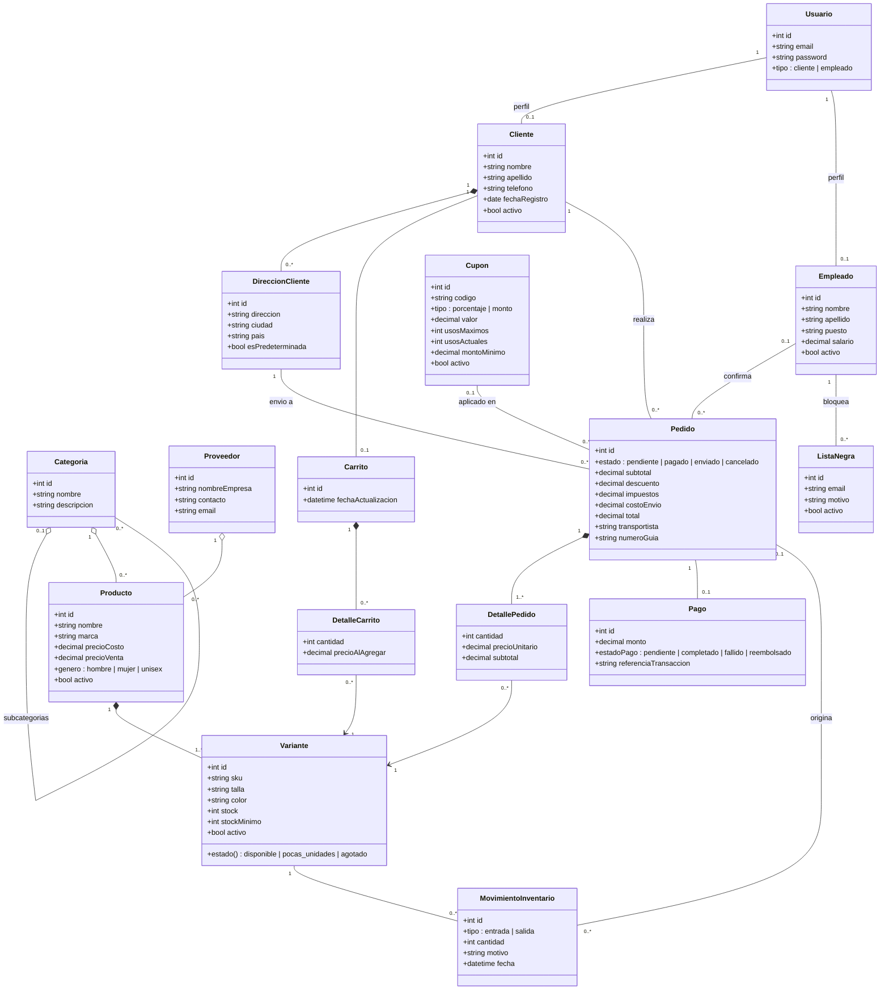

---

## 2. Diagramas de secuencia

### 2.1 Inicio de sesión y petición autenticada

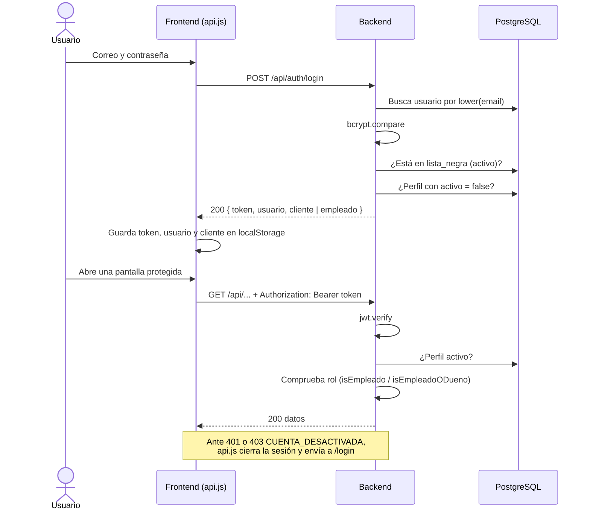

### 2.2 Creación de un pedido con cupón

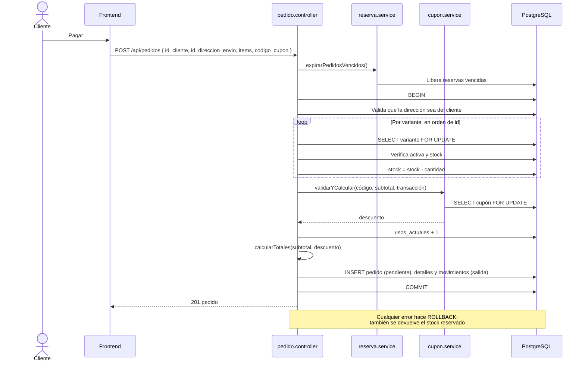

### 2.3 Pago exitoso

Ver el diagrama completo en [Pagos con Stripe](07-pagos-stripe.md#flujo-de-un-pago-exitoso).

### 2.4 Pago que llega con el pedido ya cancelado

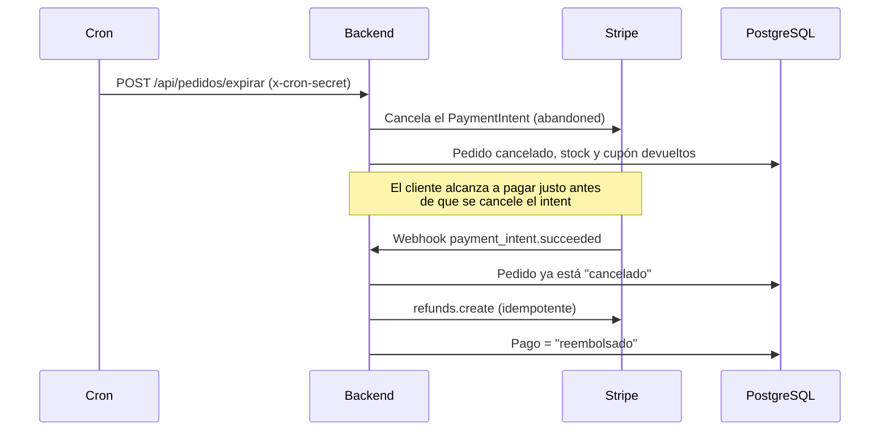

### 2.5 Reembolso por un empleado

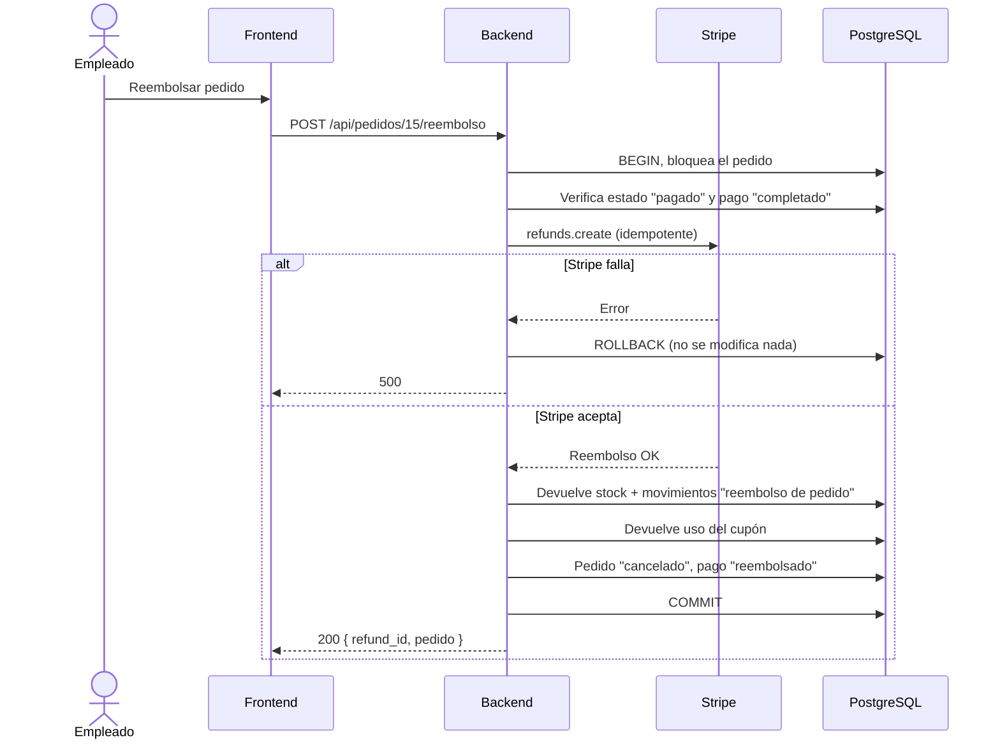

### 2.6 Ajuste manual de inventario

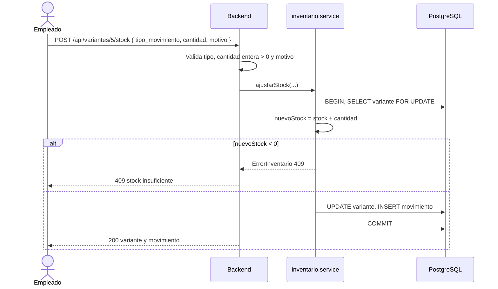

---

## 3. Diagramas de estado

### 3.1 Pedido

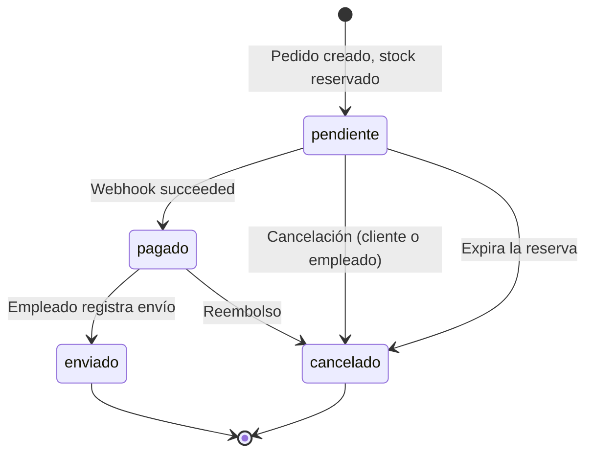

### 3.2 Pago

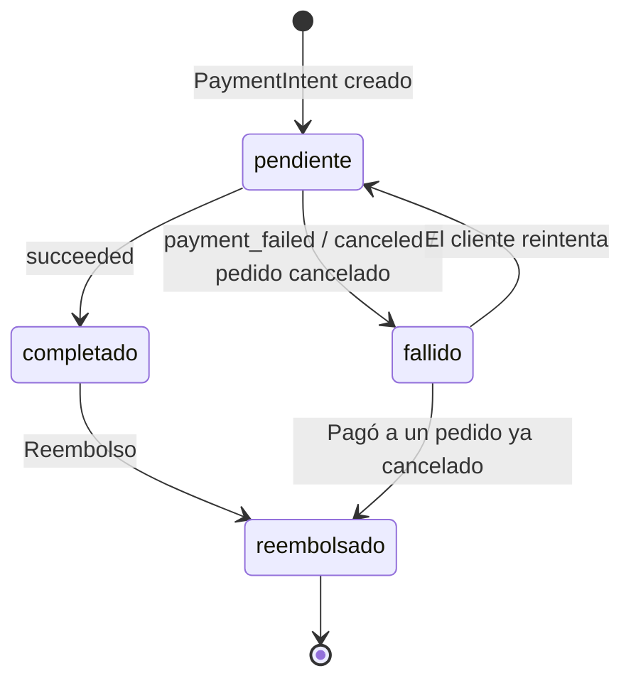

### 3.3 Cuenta de usuario

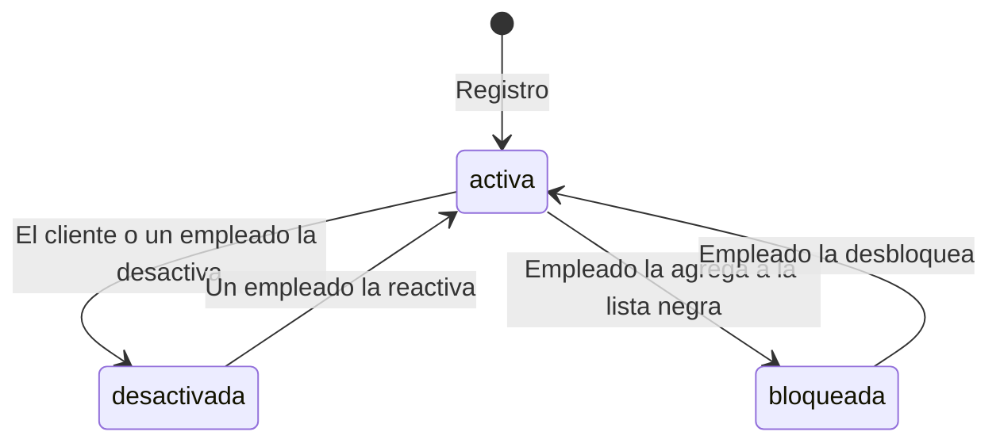

### 3.4 Disponibilidad de una variante

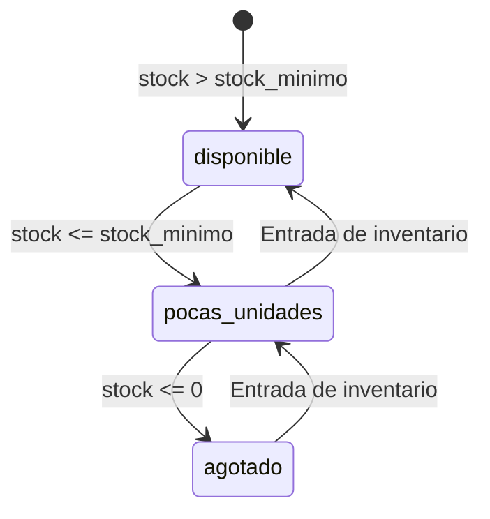

---

## 4. Diagrama de actividades: compra

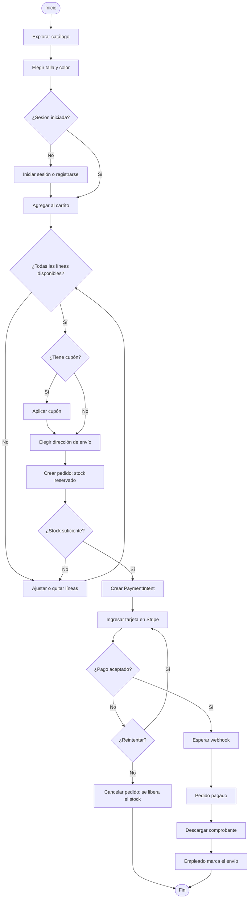

---

## 5. Diagrama de componentes

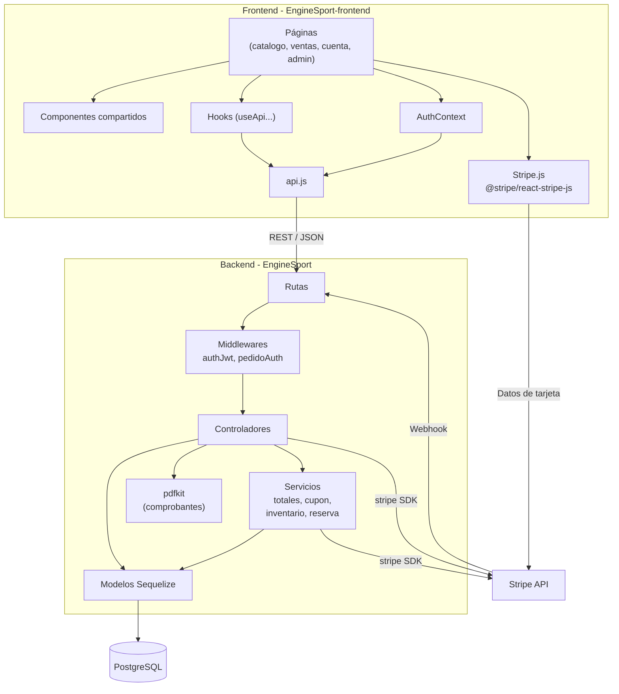

---

## 6. Diagrama de despliegue

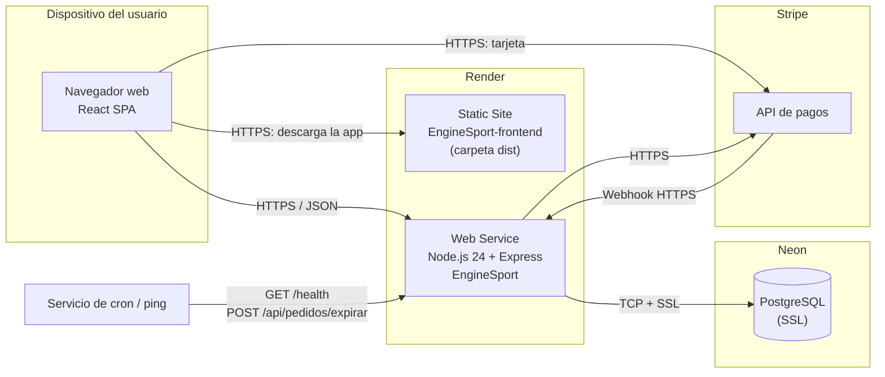
